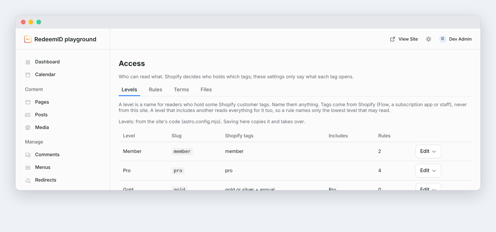

# RedeemID for EmDash

[](https://www.npmjs.com/package/@redeemid/emdash)
[](https://github.com/webmultipliers/redeemid-emdash/actions/workflows/release.yml)
[](LICENSE)

Memberships and paywalls for [EmDash](https://github.com/emdash-cms/emdash) sites, run by Shopify.

Readers sign in with the store's own customer account. Their Shopify customer tags decide what they can read. Shopify keeps the store, checkout, orders and subscriptions, and EmDash keeps the content. Nothing on the site grants access by itself, so there is one source of truth for who paid for what.



> **Status: 0.0.24, early.** Runs on Node and Cloudflare Workers. Unit tests and an end-to-end test that boots a real EmDash site against a fake Shopify store cover every feature. Expect changes before 1.0.

## How it works

1. **Sign in.** A reader clicks "Sign in", signs in on the store's customer account page, and comes back signed in as an EmDash Subscriber. That role only means "signed in". It never opens content.
2. **Mirror.** RedeemID keeps a copy of the customer: email, name, tags and whether the account is enabled. Signed Shopify webhooks keep it current.
3. **Levels.** You map tags to levels and name them whatever you like, such as `gold-member` to Gold. A level can include others, so Gold members read everything for Silver. Tags come from Shopify Flow, a subscription app or staff, never from the site.
4. **Rules.** You say which content types or terms need which levels, in the admin or in code. Each entry can have its own rule in the editor's Access panel, and editors mark where that rule starts with a Paywall break.
5. **Render.** Templates render bodies with `<Content>`. Readers who pass see everything. Everyone else gets a teaser and the wall, and the locked part never reaches the page.

Selling a membership is ordinary Shopify: a product, a checkout, and a Flow workflow that tags the customer when the order is paid. RedeemID shows the product and starts checkout, and access follows the tag.

## Features

- **For members:** sign in, Account and Sign out without ever seeing the word "Shopify"; a member card with levels, renewal and end dates; preferences saved on their customer record; download or delete what the site keeps about them.
- **For editors:** Paywall break, Members only, Sold on its own, Plan, Product, Collection, Product search, Contribution and Preferences blocks; an Access panel on every entry; teasers, a monthly or weekly meter, drip, badges and protected file downloads.
- **For staff:** Access, Members, Webhooks, App events, Reports, Setup, Status, Access test and Privacy pages in the EmDash admin. New content types and taxonomies appear on their own, so access never needs a code change.
- **For developers:** Astro components for every piece, `canRead()` and friends for your own code, a storefront from the Storefront API with a cart and a signed-in checkout, a browser client with analytics events, signed outbound events, MCP tools for AI agents and a `redeemid-emdash` command.

## Requirements

- EmDash 1.1 or later with Astro 6 or later, on Node or Cloudflare Workers (the Workers free plan is enough).
- A Shopify store with the new customer accounts, the Headless sales channel, and a Shopify app on the store to send webhooks.
- HTTPS. Shopify only accepts `https` callback URIs, so a local site needs a tunnel to sign in for real.

## Quick start

```sh
pnpm add @redeemid/emdash
```

```js title="astro.config.mjs"
import { redeemid, redeemidGuard, redeemidPlugin } from "@redeemid/emdash";
import { defineConfig } from "astro/config";
import emdash from "emdash/astro";

const config = {
	shop: "my-store.myshopify.com",
	levels: [{ slug: "member", name: "Member", tags: ["member"] }],
	rules: [{ collection: "posts", taxonomy: "category", term: "members", levels: ["member"] }],
	join: { href: "/join/", label: "Become a member" },
};

export default defineConfig({
	integrations: [
		emdash({
			// database, storage, …
			authProviders: [redeemid(config)], // sign-in, webhooks, cart and checkout routes
			plugins: [redeemidPlugin(config)], // admin pages and editor blocks
		}),
		redeemidGuard(), // gates pages and keeps members out of EmDash's own APIs
	],
});
```

Then render every body that may be locked with `<Content>` in place of `<PortableText>`:

```astro
---
import Content from "@redeemid/emdash/components/Content.astro";
---
<Content value={post.data.content} collection="posts" terms={post.data.terms} id={post.id} title={post.data.title} />
```

Set the secrets, open **Plugins → RedeemID → Setup** in the admin, and work down the steps. [Getting started](docs/getting-started.md) walks through all of it.

## Documentation

| Guide | What's in it |
| --- | --- |
| [Getting started](docs/getting-started.md) | Requirements, install, config, secrets, templates and a first check |
| [Connect a store](docs/shopify-setup.md) | The Shopify side: sign-in client, Storefront tokens and the webhook app |
| [Shopify Flow recipes](docs/shopify-flow.md) | Tag on a paid order, remove on refund or cancellation, passes that end |
| [Content and templates](docs/content.md) | `<Content>`, the Paywall break, Members only, the wall, `<Gate>`, badges, plan cards, site search and replacement text |
| [Access](docs/access.md) | Rules, levels, the Access page and the entry panel, meter and drip, selling one entry, features and protected files |
| [Shop and preferences](docs/shop.md) | Products, collections, search, the cart drawer, signed-in checkout, local prices and member preferences |
| [Staff tools, webhooks and privacy](docs/staff.md) | Member tools, membership dates, webhook health, app events, reports, AI agents, the command line and privacy requests |
| [Running in production](docs/production.md) | Caching, rate limits and troubleshooting |
| [Developer API](docs/developer-api.md) | Stable exports, JSON routes, the browser client, server events and MCP tools |
| [Reference](docs/reference.md) | Every config option, secret, component, editor block, module, route and notice |

## Guarantees

- Shopify is the only source of entitlements. Nothing on the site grants access.
- Levels read the mirrored tags as they are, however old. They change only when Shopify sends new ones.
- Locked content never reaches the content API, site search, feeds or the sitemap for readers kept out, nor a page that renders bodies with `<Content>`. The end-to-end test checks each of these.
- Staff accounts can't sign in through the store, and customers can't create the first admin account on a new site.
- Webhooks are checked against the app's signature before anything changes.
- Access fails closed: when the saved access settings can't be read, a server keeps the ones it last read, and with none it locks every entry.

## Contributing

Issues and pull requests are welcome. Work branches from `main`, and pull requests go back into it.

```sh
pnpm install
pnpm test        # unit tests
pnpm typecheck
pnpm e2e         # boots the playground site against a fake Shopify store
```

`playground/` is the EmDash starter template with RedeemID wired in and locked posts in its seed. The package ships TypeScript source; there is no build step.

Every change keeps the guarantees above: Shopify stays the only source of access, missing or unreadable data gives readers less access rather than more, and no secret, token or personal data is logged or returned.

**Releases.** Bump `version` in package.json and merge to main. The Release workflow runs the tests, stages that version on npm and cuts a matching GitHub release, `v<version>`, with the exact tarball and a `.sha256`. A maintainer approves the npm stage before it's public.

## Security

Please report security problems privately through the repository's **Security** tab rather than in a public issue.

## License

MIT, the same as EmDash. Copyright Vinny S. Green, LLC.
